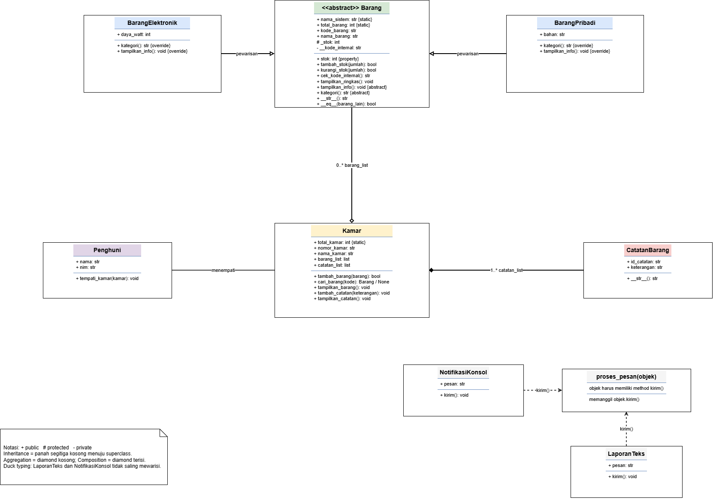

# Sistem Pendataan Barang di Kamar Kos

**NIM:** 2509106128 · **Nama:** Meilonie · **Materi:** Relasi UML, abstraksi, polimorfisme, dan prinsip SOLID.

## 1. Deskripsi Program

Program ini membantu mencatat barang yang ada di kamar kos. Pengguna dapat melihat, menambah, mencari, memperbarui stok, dan menghapus data barang, serta mengelola catatan kamar. Program dikembangkan dari kode sebelumnya dengan mempertahankan kelas `Barang`, `BarangElektronik`, `BarangPribadi`, `Kamar`, `CatatanBarang`, dan `Penghuni`, berikut atribut stok, kode internal, inheritance, serta contoh relasi antarkelas.

## 2. Struktur Kelas

STRUKTUR KELAS SISTEM PENDATAAN BARANG DI KAMAR KOS

1. Kelas Barang (Abstrak)

Deskripsi:
Menyimpan informasi umum barang dan mengelola stok.

Atribut:
- kode_barang
- nama_barang
- _stok
- __kode_internal
Method:
- tambah_stok()
- kurangi_stok()
- tampilkan_ringkas()
- tampilkan_info()
- kategori()
Hubungan:
Merupakan kelas induk (parent class) bagi BarangElektronik dan BarangPribadi.

2. Kelas BarangElektronik

Deskripsi:
Menyimpan informasi khusus barang elektronik.

Atribut:

- daya_watt

Method:
- tampilkan_info()
- kategori()
Hubungan:
Mewarisi atribut dan method dari kelas Barang.

3. Kelas BarangPribadi

Deskripsi:
Menyimpan informasi khusus barang pribadi.

Atribut:

- bahan

Method:
- tampilkan_info()
- kategori()
Hubungan:
Mewarisi atribut dan method dari kelas Barang.

4. Kelas Kamar

Deskripsi:
Mengelola daftar barang dan catatan yang berkaitan dengan kamar.

Atribut:
- nomor_kamar
- nama_kamar
- barang_list
- catatan_list
Method:
- tambah_barang()
- cari_barang()
- tampilkan_barang()
- tambah_catatan()
Hubungan:
Memiliki hubungan agregasi dengan Barang dan hubungan komposisi dengan CatatanBarang.

5. Kelas CatatanBarang

Deskripsi:
Menyimpan informasi catatan terkait kamar.

Atribut:
- id_catatan
- keterangan
Method:

- str()

Hubungan:
Menjadi bagian dari Kamar melalui hubungan komposisi.

6. Kelas Penghuni

Deskripsi:
Menyimpan identitas penghuni dan mengatur kamar yang ditempati.

Atribut:
- nama
- nim
Method:

- tempati_kamar()

Hubungan:
Memiliki hubungan asosiasi dengan Kamar.

7. Kelas LaporanTeks

Deskripsi:
Menyediakan fungsi untuk menampilkan laporan berbentuk teks.

Atribut:

- pesan

Method:

- kirim()

Hubungan:
Menerapkan konsep duck typing melalui method kirim() tanpa mewarisi kelas NotifikasiKonsol.

8. Kelas NotifikasiKonsol

Deskripsi:
Menyediakan fungsi untuk menampilkan notifikasi melalui konsol.

Atribut:

- pesan

Method:

- kirim()

Hubungan:
Menerapkan konsep duck typing melalui method kirim() tanpa mewarisi kelas LaporanTeks.

KETERANGAN NOTASI UML
- Tanda + menunjukkan atribut atau method public.
- Tanda # menunjukkan atribut atau method protected.
- Tanda - menunjukkan atribut atau method private.
PENJELASAN HUBUNGAN ANTARKELAS

1. Inheritance (Pewarisan)

BarangElektronik dan BarangPribadi merupakan kelas turunan dari kelas abstrak Barang.

2. Aggregation (Agregasi)

Kamar mengelola daftar objek Barang. Objek barang dapat tetap ada meskipun tidak lagi terdaftar di kamar tersebut.

3. Composition (Komposisi)

CatatanBarang merupakan bagian dari Kamar sesuai rancangan sistem.

4. Association (Asosiasi)

Penghuni memiliki hubungan dengan Kamar melalui method tempati_kamar().

5. Duck Typing

## 3. Class Diagram dan Relasi UML

### Asosiasi — `Penghuni` dan `Kamar`

Method `Penghuni.tempati_kamar(kamar)` menerima objek `Kamar` yang telah dibuat dari luar. Penghuni mengetahui kamar yang ditempati, tetapi tidak membuat atau memiliki siklus hidup kamar. Pada diagram, gunakan garis utuh biasa.

### Agregasi — `Kamar` dan `Barang`

Objek barang dibuat di luar `Kamar`, lalu diberikan melalui `tambah_barang(barang)`. Barang masih merupakan objek tersendiri dan secara konsep dapat tetap ada meskipun dikeluarkan dari daftar kamar. Pada diagram, gunakan garis utuh dengan **diamond kosong di sisi `Kamar`**.

### Komposisi — `Kamar` dan `CatatanBarang`

Method `Kamar.tambah_catatan()` membuat objek `CatatanBarang` di dalam `Kamar` dan menyimpan catatan pada `catatan_list`. Dalam model ini catatan merupakan bagian yang dimiliki kamar. Pada diagram, gunakan garis utuh dengan **diamond hitam di sisi `Kamar`**.

**Perbedaan utama:** agregasi menunjukkan hubungan “memiliki” yang bagian objeknya dapat berdiri sendiri; komposisi menunjukkan kepemilikan lebih kuat dan siklus hidup bagian dimodelkan bergantung pada pemilik. Python tidak otomatis menghapus objek hanya karena pemiliknya dihapus; ini merupakan aturan desain program.

## 4. Abstraksi

`Barang` merupakan abstract class karena mewarisi `ABC`. Kelas ini menetapkan dua kontrak:

- `tampilkan_info()`: setiap subclass harus menampilkan detail barangnya.
- `kategori()`: setiap subclass harus mengembalikan kategori barang.

`BarangElektronik` dan `BarangPribadi` mengimplementasikan kedua method tersebut. Keduanya memanggil `super().__init__(...)` agar data umum diatur oleh kelas induk. Method konkret `tampilkan_ringkas()` diwariskan dan dapat digunakan bersama. Atribut `_stok` menunjukkan konvensi protected, sedangkan `__kode_internal` menggunakan name mangling untuk membatasi akses langsung.

Untuk membuktikan kelas abstrak tidak dapat dibuat langsung, pilih menu **10**. Program menangkap `TypeError` dari Python dan mencetak pesan aktual yang berisi method abstrak yang belum diimplementasikan.

## 5. Polimorfisme

### A. Melalui inheritance (override)

`BarangElektronik` dan `BarangPribadi` sama-sama mengimplementasikan `tampilkan_info()` dan `kategori()` dengan hasil berbeda. Menu **9** menjalankan satu loop atas `kamar.barang_list`; Python memilih method sesuai objek sebenarnya.

### B. Duck typing

`LaporanTeks` dan `NotifikasiKonsol` tidak memiliki hubungan pewarisan, tetapi keduanya menyediakan method `kirim()`. Fungsi `proses_pesan(objek)` hanya memanggil `objek.kirim()`, tanpa perlu memeriksa tipe objek.

### C. Operator overloading

`Barang.__str__()` menentukan tampilan saat objek dikonversi ke teks atau dicetak. `Barang.__eq__()` menentukan kesetaraan berdasarkan `kode_barang`, sehingga dua objek dengan kode yang sama dianggap mewakili barang berkode sama. Demonstrasi tersedia di menu **9**.

## 6. Kesimpulan

Program mempertahankan pendataan barang di kamar kos dan menambahkan menu CRUD sederhana. Struktur OOP menggunakan pewarisan dan abstraksi untuk jenis barang, polimorfisme melalui override, duck typing dan operator overloading, serta contoh asosiasi, agregasi, dan komposisi. Dokumentasi dan diagram menjelaskan cara menjalankan serta menguji setiap konsep.

## 7. SOLID yang diterapkan

Prinsip **Open/Closed Principle (OCP)** diterapkan secara sederhana pada jenis barang: untuk menambah kategori, buat subclass baru dari `Barang` dan implementasikan `tampilkan_info()` serta `kategori()`. Loop pada `Kamar.tampilkan_barang()` tetap dapat memanggil method yang sama tanpa menambahkan rantai `if/elif` berdasarkan jenis barang. Prinsip ini mengurangi kebutuhan mengubah kode yang sudah ada ketika kategori baru ditambahkan.